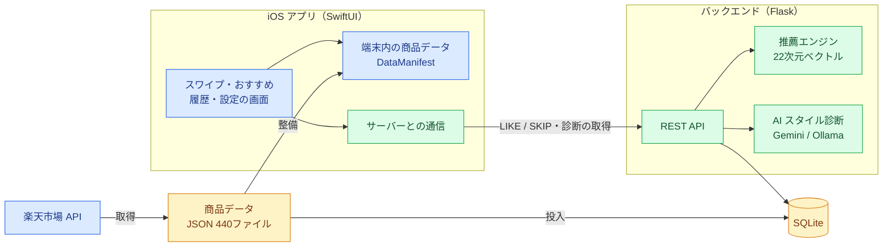

# Swipe Fashion — スワイプで好みを学習するファッション推薦アプリ

服の写真を右（LIKE）か左（SKIP）にスワイプするだけで好みを学習し、おすすめの服を表示する iOS アプリです。
LIKE が10件たまると、AI が「あなたはこういう服が好きな傾向があります」という説明文を作ります。商品は楽天市場の商品検索 API から取得した実際の商品データを使っています。

ファッション EC の「商品が多すぎて、自分に合う服にたどり着けない」という課題に対して、入力の手間をかけずに好みを集める方法として企画し、3人のチームで開発しました。
私（shu）は企画の立案とチームの進行、iOS アプリ、楽天 API からの商品データの取得を担当しています。
推薦の精度だけでなく、**入力の手間をかけずに好みを集め、その好みを言葉にして返すこと**を重視して設計しています。

## 特徴

* **スワイプだけで好みを入力** — 服のカードを右（♡）か左（✕）に動かすだけです。アンケートや検索条件の入力はいりません
* **LIKE が3件たまるとおすすめが変わる** — LIKE した服とジャンルが同じで、価格が近い商品をおすすめ画面に20件並べます
* **AI スタイル診断** — LIKE が10件たまると、よく LIKE するスタイルやショップをもとに、好みの傾向を AI が文章で説明します
* **実際の楽天の商品** — 楽天市場 API から取得した商品を表示し、タップすると商品ページをアプリ内のブラウザで開けます
* **絞り込み** — カテゴリ（レディース / メンズ）・価格帯（3区分）・アイテム種別（トップス / ボトムス / シューズ / ワンピース）で絞り込めます
* **LIKE の履歴** — LIKE した服を一覧でき、長押しで1件ずつ、またはまとめて削除できます
* **サーバーが止まっていても使える** — 通信に失敗しても、スワイプ・おすすめ・履歴は端末内のデータで動き続けます

## 画面

| スワイプ | おすすめ・AI スタイル診断 | 履歴 | 設定 |
|:--:|:--:|:--:|:--:|
|  |  |  |  |

## チームと担当

3人で役割を分け、約2週間で開発しました。

| メンバー | 担当 |
| --- | --- |
| shu（私） | 企画の立案・チームの進行、iOS アプリ（スワイプ・おすすめ・履歴・設定の画面、端末内のおすすめ計算、絞り込み、画像キャッシュ）、楽天 API のアプリ登録と商品データの取得、データの形の決定 |
| Shiyu Akamatsu | バックエンド API（Flask）、推薦エンジン、AI スタイル診断（LLM）、iOS アプリとサーバーをつなぐ通信部分、ブランチの統合 |
| データ担当メンバー | データベース、楽天 API から返ってきた商品データの整備 |

担当ごとに色を分けると、システムは次のようになります（青: shu / 緑: Shiyu Akamatsu / 黄: データ担当メンバー）。



| 時期 | やったこと |
| --- | --- |
| 1〜3日目 | テーマ決め・役割分担、画面のモックを使った認識合わせ |
| 4日目〜 | 各自のブランチ（frontend / backend / rakuten-api）で実装 |
| 8日目 | 3人の成果物を統合し、通信の不具合やデータの形のずれを修正 |
| 11日目 | スワイプ・おすすめ・AI スタイル診断・履歴がそろった状態で完成 |

> **git の記録について**
> データ担当メンバーは Git を使ったことがなかったため、整備したデータはチャットで直接受け取り、私が中身を確認してリポジトリに入れました。そのため、データ担当のコミットはありません。
> また、各自のブランチは最後に統合用のブランチでまとめて取り込んだため、楽天 API まわりなど一部のコードは、統合を担当した Shiyu Akamatsu の名前で記録されています。

## チーム開発で工夫したこと

### 作る前に、画面のモックで3人の認識をそろえた

開発に入る前に、私が Figma でアプリの画面のモックを作り、3人で見ながら「どんな画面で、何ができるアプリか」をすり合わせました。
言葉だけで仕様を説明すると、スワイプの動きやおすすめ画面に何を出すかの受け取り方が、人によってずれやすくなります。先に画面を見せることで、フロントエンド・バックエンド・データの担当が、それぞれ「自分は何を用意すればいいか」を同じイメージで考えられるようにしました。

### 統合のときに合わなかったデータの形を、楽天 API の形にそろえた

最初は3人がそれぞれのブランチで別々に作業していたため、つなごうとした段階で、アプリ・サーバー・データベースの間で商品データの項目名や形がばらばらになっていました。
そこで、商品データは楽天 API のレスポンスの形（`itemCode`・`itemName`・`itemPrice`・`mediumImageUrls` など）にそろえると決め、サーバーの API もこの形で返すように統一しました。アプリが読む JSON・データベース・API が返すデータの項目名がそろい、つなぐときの変換がほとんどいらなくなりました。

振り返ると、画面のイメージは最初にモックでそろえられた一方で、データの形と API の仕様までは決めていませんでした。ここも作業を分ける前に決めておけば、統合の手間はもっと小さくできました。次のチーム開発では、画面と一緒にデータの形も最初に3人で合わせるところから始めます。

### Git を使わないメンバーとも作業を止めない

データ担当メンバーは Git を使ったことがなかったので、整備したデータをチャットで直接送ってもらい、私がリポジトリに入れる流れにしました。
受け取ったデータはキーワードごとの JSON ファイルのまま `FashionSwipe/Data/` に置き、アプリで使うファイルは `DataManifest.json` に書き足すだけで増やせるようにしています。データが届くたびに Swift のコードを直す必要はありません。

受け取った440ファイル・12,973件の商品データは、すべてアプリの商品モデルでそのまま読み込めることを確認しています。

### 進行役として、仕様のずれを早めに拾う

企画を出した立場として、テーマ決め・役割分担・進捗の確認を担当しました。
3人が別々の部分を作っていたので、それぞれが必要としているデータの形や「どこまで作るか」を確認し、認識のずれを整理することを意識しました。
統合の作業そのものは Shiyu Akamatsu が中心でしたが、私も仕様の確認と動作確認に入り、3人の成果物が1つのアプリとしてつながるところまで一緒に詰めました。

## 企画の背景と収益化

ファッション EC の市場は大きい（衣料・服飾雑貨の EC 市場は約2.6兆円、EC 化率は24.8%。経済産業省「令和4年度 電子商取引に関する市場調査」）一方で、商品が多すぎて「自分に合う服が見つからない」という課題があります。検索条件をいくつも指定するのは面倒で、AI のおすすめも、なぜその商品が出てきたのかが分かりません。
そこで、TikTok などで慣れたスワイプ操作を服選びに持ち込み、入力の手間をかけずに好みを集めて、AI がその好みを言葉で返す、という形を考えました。

| | 既存のファッション EC | Swipe Fashion |
| --- | --- | --- |
| 探し方 | キーワード検索・絞り込み | スワイプで直感的に評価 |
| おすすめの根拠 | 売れ筋・閲覧履歴 | 一人ひとりの LIKE / SKIP |
| 好みの集め方 | 閲覧などから推測する | LIKE / SKIP ではっきり受け取る |
| おすすめの説明 | なし | AI が好みを文章で説明 |

収益化は、次の順に段階を踏む想定です。

1. **使ってもらえるかの検証** — 楽天の商品とスワイプの組み合わせで、まず使い続けてもらえるかを確かめる
2. **アフィリエイト** — おすすめから楽天の商品ページへ送客し、紹介料を得る
3. **有料の詳しい診断** — プレミアム会員向けに、より詳しいスタイル診断を提供する
4. **ブランド向けのレポート（B2B）** — 匿名化した好みのデータをクラスタ分析し、ブランド向けのレポートとして提供する。K-means によるユーザーのクラスタリングは、この分析を見据えて実装しています

月々の運用コストは約11,200円からと試算しました。

## 商品データ

| 項目 | 内容 |
| --- | --- |
| 取得元 | 楽天市場 商品検索 API |
| 取得方法 | ファッション関連の440キーワードで検索し、1キーワードにつき30件ずつ JSON で保存 |
| 件数 | 440ファイル・12,973件（同じ商品の重複を除くと12,296件） |
| データの形 | 楽天 API のレスポンスの形のまま（`itemCode`・`itemName`・`itemPrice`・`mediumImageUrls` など） |
| アプリでの使い方 | カテゴリ分けを済ませた41キーワード分（1,230件）を `DataManifest.json` に登録し、スワイプに表示 |
| サーバーでの使い方 | 440ファイルすべてを起動時に SQLite へ入れ、推薦用のベクトルに変換 |

## 使い方

```bash
git clone https://github.com/shu8719/swipe-fashion.git
cd swipe-fashion
```

### 1. サーバー（バックエンド・推薦エンジン）

Python 3.10 以降を使います。

```bash
python3 -m venv .venv
source .venv/bin/activate
pip install -r requirements.txt
cp .env.example .env    # このままで動きます（AI スタイル診断は固定の文章を返す mock）
python -m backend.app   # http://localhost:5001 で起動
```

起動するたびに `FashionSwipe/Data` の商品データをデータベースに入れてベクトルに変換するため、使えるようになるまで30秒ほどかかります。
テストは `pytest` で実行できます。

AI スタイル診断を実際の LLM で試す場合は、`.env` の `LLM_PROVIDER` を `gemini`（`GOOGLE_API_KEY` が必要）か `ollama` に変えてください。

### 2. iOS アプリ

```bash
open FashionSwipe.xcodeproj
```

Xcode でシミュレータを選んで実行してください（iOS 26.5 以降が対象です）。シミュレータからは `http://127.0.0.1:5001` のサーバーに自動でつながります。
実機で動かす場合は、ビルド設定にユーザー定義の `API_BASE_URL` を追加し、サーバーを動かしている Mac のアドレス（例: `http://<Mac のホスト名>.local:5001`）を設定してください。

サーバーを起動していなくても、スワイプ・おすすめ・履歴は動きます（AI スタイル診断だけ表示されません）。

## 技術スタック

| 分類 | 技術 |
| --- | --- |
| iOS アプリ | Swift 5 / SwiftUI、MVVM、async/await |
| バックエンド | Python / Flask |
| データベース | SQLite |
| 推薦 | scikit-learn（コサイン類似度・K-means）/ NumPy |
| AI スタイル診断 | Gemini / Ollama（LLM なしで動かす mock にも切り替え可） |
| 商品データ | 楽天市場 商品検索 API |
| デザイン | Figma（開発前の画面モック） |
| テスト | pytest |

企画の段階では Web（React）と MySQL を考えていましたが、スワイプの操作感を優先して SwiftUI のネイティブアプリに、手元ですぐ動かせることを優先して SQLite に変えました。

## API

| エンドポイント | 内容 |
| --- | --- |
| `POST /api/auth/device` | 端末ごとの ID で自動ログインし、トークンを返します（ログイン画面なしで使い始められます） |
| `POST /api/auth/register` `/api/auth/login` | メールアドレスでの登録・ログイン（現在のアプリでは未使用） |
| `GET /api/items/next` | まだ評価していない商品を返します |
| `GET /api/items/<item_code>` | 商品1件の詳細を返します |
| `POST /api/actions` | LIKE / SKIP を記録します（同じ操作は二重に記録しません） |
| `GET /api/recommend` | 好みに近い順のおすすめ商品を、スコア付きで返します |
| `GET /api/favorites` | LIKE した商品の一覧を返します |
| `GET /api/taste` | AI が作った好みの説明文を返します |

リクエストとレスポンスの詳細は [docs/api_spec.md](docs/api_spec.md) にあります。

## プロジェクト構成

```text
swipe-fashion/
├── FashionSwipe/          # iOS アプリ（SwiftUI）
│   ├── Views/             # 画面（スワイプ・おすすめ・履歴・設定）と画像キャッシュ
│   ├── ViewModels/        # 状態の管理・LIKE の保存・端末内のおすすめ計算
│   ├── Models/            # 商品（楽天 API の形）・プロフィール
│   ├── Services/          # 商品データの読み込み（DataManifest）とサーバーとの通信
│   └── Data/              # 楽天 API から取得した商品 JSON（440ファイル）と DataManifest.json
├── backend/               # Flask の REST API
│   ├── routes/            # 認証・商品・LIKE/SKIP・おすすめ・お気に入り・好みの説明文
│   ├── ai/                # K-means クラスタリング・LLM による説明文の生成
│   ├── ingest/            # 楽天 API からの商品取得
│   ├── jobs/              # クラスタリングのバッチ
│   └── tests/             # pytest
├── recommender/           # 商品テキスト → 22次元ベクトル、好みとのコサイン類似度で推薦
├── docs/api_spec.md       # API 仕様
└── import_data.py         # 商品データの投入とベクトル化をまとめて行うスクリプト
```

## おすすめの流れ

1. **スワイプ** — LIKE / SKIP は端末に保存し、同時に裏でサーバーへ送ります。送信に失敗しても画面は止めません
2. **端末内のおすすめ** — LIKE が3件たまると、LIKE した服とジャンルが同じ商品を優先し、LIKE した服の平均価格に近い順に並べて上位20件を表示します
3. **商品を数値にする** — サーバーでは、商品名とキャッチコピーをキーワード辞書でタグに分け、22次元のベクトル（スタイル6・色4・シルエット4・素材5・価格帯3）にします
4. **好みを数値にする** — LIKE を +1、SKIP を -0.5 として、新しい評価ほど重くなるように平均し、ユーザーの好みのベクトルを作ります
5. **推薦** — 好みのベクトルと各商品のベクトルのコサイン類似度で並べ、上位20件を返します（`/api/recommend`）
6. **AI スタイル診断** — LIKE が10件たまるごとに、よく LIKE するタグやショップを LLM に渡して、好みの説明文を作り直します

現在のアプリのおすすめ画面は 2 の端末内の計算を使っています。3〜5 のサーバー側の推薦にアプリをつなぐのは、今後の改善点です（通信部分は実装済み）。

## 工夫した点

### 商品データを増やしても Swift のコードを直さない

最初は、レディース・メンズ・ワンピースの3つの JSON ファイルをコードの中で指定して読み込んでいました。
しかし楽天 API から取得したデータは440ファイルあり、ファイル名をコードに書く方式では、データを足すたびに Swift のコードを直してビルドし直す必要があります。
そこで、カテゴリ（メンズ / レディース / 男女兼用）ごとのファイル名を `DataManifest.json` に書き、アプリはそれを読んで対象のファイルを決めるようにしました。データを増やすときは JSON を1行足すだけです。`DataManifest.json` が見つからない場合は、元の3ファイルを読む動きに戻ります。

### 画像を取り直さない

SwiftUI 標準の `AsyncImage` はキャッシュを持たないため、カードが切り替わったり一覧をスクロールしたりするたびに、同じ画像をネットワークから取り直していました。
そこで、`AsyncImage` と同じ書き方のまま置き換えられる `CachedAsyncImage` を作りました。一度読んだ画像はメモリ（NSCache）に残し、ディスクのキャッシュ（URLCache）も併用するので、2回目以降はすぐに表示されます。

### スワイプした直後にカードがガタつかない

スワイプした直後、後ろにあったカードが一瞬で大きくなって前に出てくるため、動きがガタついて見える問題がありました。
重なっている3枚のカードを1つの `ForEach` で、商品 ID をキーにして描画するように変えました。後ろのカード（0.97倍）が前に出るときの拡大もアニメーションするので、次のカードがなめらかに前に出てきます。

### サーバーが止まっていてもアプリを止めない（担当: Shiyu Akamatsu）

最初は通信が終わるまで画面が待たされ、サーバーにつながらないと、おすすめ画面で読み込み中の表示が1分ほど続いていました。
通信のタイムアウトを5秒にし、LIKE をまとめて送り直す処理は並列にして裏で行うようにしました。AI スタイル診断の取得も1回だけ試すようにしたので、サーバーにつながらなくても画面はすぐに使えます。

### おすすめの理由を追える推薦（担当: Shiyu Akamatsu）

推薦には中身の見えないモデルを使わず、商品をスタイル・色・シルエット・素材・価格帯の22個のタグに分けて数値にしています。
どのタグが好みのベクトルを押し上げているかを見れば、なぜその服が出てきたのかを説明できます。AI スタイル診断も、この集計結果（よく LIKE するタグ・ショップ）を材料にして文章を作っています。

## 今後の改善点

* アプリのスワイプとおすすめを、サーバーの推薦（`/api/items/next`・`/api/recommend`）から取るように切り替える
* `DataManifest.json` に登録していない残り約400キーワード分の商品をカテゴリ分けし、アプリに追加する
* SKIP の履歴をアプリにも保存し、履歴から削除した LIKE をサーバーにも反映する
* K-means のクラスタ（好みが似たユーザーのグループ）を使ったおすすめ
* トップスとボトムスの組み合わせの提案、季節や天気を考えたおすすめ
* 推薦の精度を数字で測る仕組み
