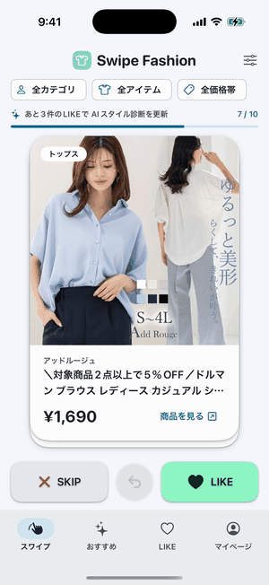
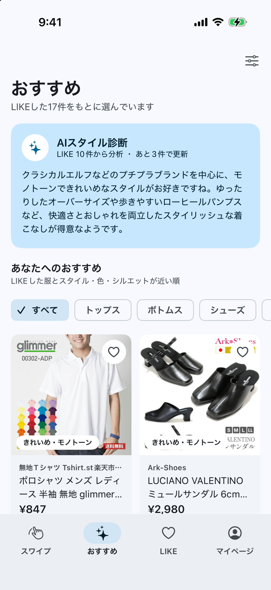
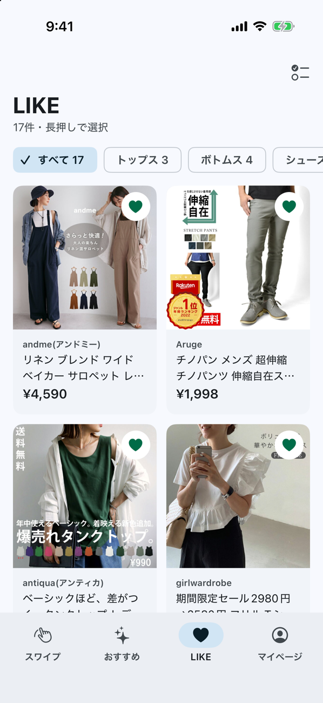
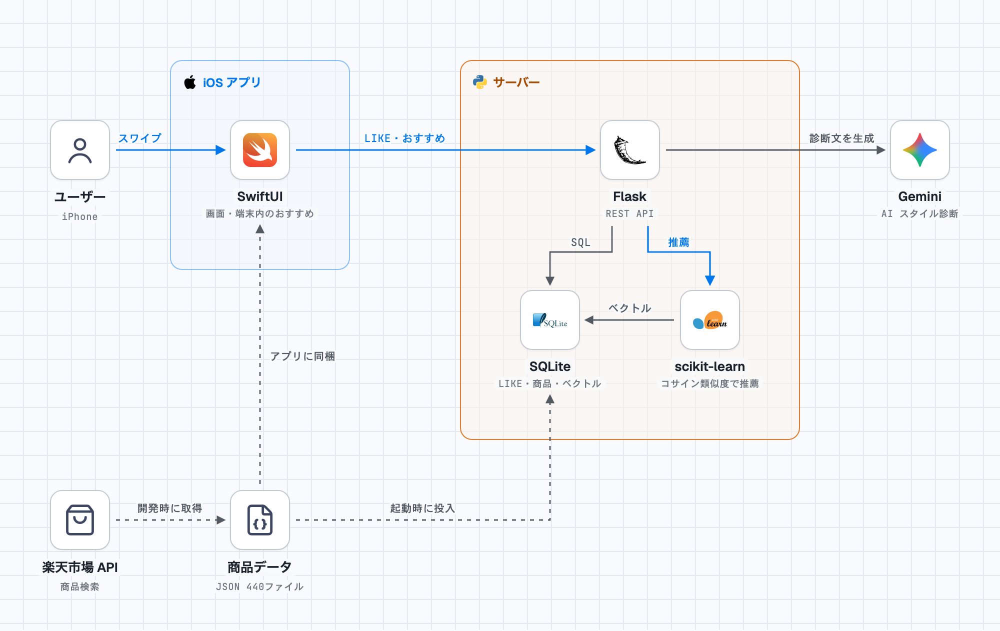

# Swipe Fashion — スワイプで好みを学習するファッション推薦アプリ

服の写真を右（LIKE）か左（SKIP）にスワイプするだけで好みを学習し、理由付きのおすすめと AI のスタイル診断を返す iOS アプリです。商品は楽天市場 API から取得した実際の商品を使っています。

3人のチームで約2週間で開発しました。私（shu）は企画・進行と iOS アプリ、楽天市場 API からの商品データの取得を担当しています。

<p align="center"></p>

## 特徴

* **理由付きのおすすめ** — LIKE が3件たまると、スタイル・色・シルエットが近い服を「モノトーン・きれいめ」のような理由と一緒に並べます
* **AI スタイル診断** — LIKE が10件たまるごとに、好みの傾向を Gemini が文章にします
* **サーバーが止まっていても使える** — 通信できないときは、端末内のデータでスワイプとおすすめを続けます

## 画面

| スワイプ | おすすめ・AI スタイル診断 | LIKE | マイページ |
|:--:|:--:|:--:|:--:|
|  |  |  |  |

## 企画の背景

**なぜ作ったか** — ファッション EC は市場が大きい一方（国内 2.6兆円、経済産業省 2022年）、商品が多すぎて自分に合う服にたどり着きにくく、検索条件を何度も指定するのは面倒です。AI のおすすめも、なぜその商品なのかが分かりません。そこで、Instagram や TikTok で慣れたスワイプ操作で入力の手間なく好みを集め、その好みを言葉にして返すアプリを考えました。

**既存の EC との違い**

| | 既存のファッション EC | Swipe Fashion |
| --- | --- | --- |
| 探し方 | キーワード検索・絞り込み | スワイプで直感的に評価 |
| おすすめの根拠 | 売れ筋・閲覧履歴 | 一人ひとりの LIKE / SKIP |
| おすすめの説明 | なし | AI が好みを文章で説明 |

**ビジネスモデル** — まず楽天の商品で使い続けてもらえるかを確かめ、おすすめから楽天への送客（アフィリエイト）と、有料の詳しい診断で収益を得る想定です。その先は、匿名化した好みのデータを分析し、ブランド向けのレポートとして提供することも考えています。

## システム構成

<picture>
  <source media="(prefers-color-scheme: dark)" srcset="docs/architecture-dark.png">
  
</picture>

| 分類 | 技術 |
| --- | --- |
| iOS アプリ | Swift / SwiftUI |
| サーバー | Python / Flask / SQLite |
| 推薦 | scikit-learn / NumPy（22次元のタグとコサイン類似度） |
| AI スタイル診断 | Gemini 3.5 Flash |
| 商品データ | 楽天市場 商品検索 API（440キーワード・12,266件） |
| テスト | pytest |

API の詳細は [docs/api_spec.md](docs/api_spec.md) にあります。

## チームと担当

| メンバー | 担当 |
| --- | --- |
| shu（私） | 企画・進行、iOS アプリ、楽天市場 API からの商品データの取得 |
| Shiyu Akamatsu | サーバー（Flask）、推薦エンジン、AI スタイル診断、アプリとサーバーの通信、ブランチの統合 |
| データ担当メンバー | データベース、商品データの整備 |

チーム開発のあと、UI の再設計や、おすすめをサーバーの推薦につなぐ改善などを私が行いました（下の「技術的に工夫したこと」で「チーム開発後」と付けたもの）。

> データ担当メンバーは Git を使ったことがなかったため、整備したデータは私が受け取ってリポジトリに入れました。そのためコミットはありません。統合用のブランチでまとめて取り込んだため、一部のコードやデータは Shiyu Akamatsu の名前で記録されています。

## チーム開発で工夫したこと

### 作る前に、画面のモックで認識をそろえた

開発に入る前に私が Figma で画面のモックを作り、3人で「どんな画面で、何ができるアプリか」をすり合わせました。

### 合わなかったデータの形を、楽天市場 API の形にそろえた

統合の段階で、アプリ・サーバー・データベースの間で商品データの項目名がばらばらでした。楽天市場 API のレスポンスの形（`itemCode`・`itemName` など）にそろえると決め、変換をほぼなくしました。

画面はモックでそろえた一方、データの形は最初に決めていませんでした。次は、画面と一緒にデータの形も最初に合わせます。

## 技術的に工夫したこと

### サーバーの推薦につなぎ、つながらないときは端末内に戻す（チーム開発後）

チーム開発の時点では、サーバーの推薦はアプリから使われていませんでした。おすすめ画面を開いたときに `/api/recommend` を呼び、つながらないときは端末内の計算（ジャンルと価格の近さ）に戻すようにしました。
サーバーの候補1万2千件のうち、アプリに載せているのは1,207件だけです。そのまま上位20件を取るとトップス・ボトムスなどで絞ったときに数件しか残らないため、アプリの商品だけから選ぶ指定（`scope=app`）を足し、多めに取って端末側で絞っています。

### タグの偏りを測って直した（チーム開発後）

推薦と AI スタイル診断の元になる商品のタグを実データで測ると、72%のスタイルが「カジュアル」でした。キーワードに当たらない商品を「カジュアル」で埋めていたことと、先に書いたタグを優先していたことが原因です。
初期値で埋めるのをやめ、当たった回数が一番多いタグを選ぶようにして、カジュアルは33%になりました。

### スワイプ直後のカードのガタつきをなくした

後ろのカードを縮めて重ねていたため、スワイプ直後に一瞬で大きくなり、動きがガタついていました。重なったカードを商品 ID をキーにした1つの `ForEach` で描き、後ろのカードは等倍のまま少し下で待たせる形にして、拡大そのものをなくしました。

### 商品データを増やしてもコードを直さない

楽天市場 API から取得したデータは440ファイルあります。ファイル名をコードに書くと、データを足すたびにビルドし直しになるため、カテゴリごとのファイル名を `DataManifest.json` に書き、アプリはそれを読むようにしました。

## 使い方

サーバーは Python 3.10 以降で動きます。

```bash
git clone https://github.com/shu8719/swipe-fashion.git
cd swipe-fashion/server
python3 -m venv .venv && source .venv/bin/activate
pip install -r requirements.txt
cp .env.example .env    # AI スタイル診断は固定の文章（mock）。Gemini を使うときは LLM_PROVIDER=gemini と GOOGLE_API_KEY を設定
python -m backend.app   # http://localhost:5001
```

iOS アプリは `ios/FashionSwipe.xcodeproj` を Xcode で開き、シミュレータで実行します（iOS 26.5 以降）。実機ではスキームの環境変数 `API_BASE_URL` に Mac のアドレスを設定してください。テストは `server/` で `pytest` を実行します。

## 今後の改善点

* スワイプに出す商品もサーバーから取る
* 残り約400キーワード分の商品をアプリに追加する
* 推薦の精度を数字で測る
